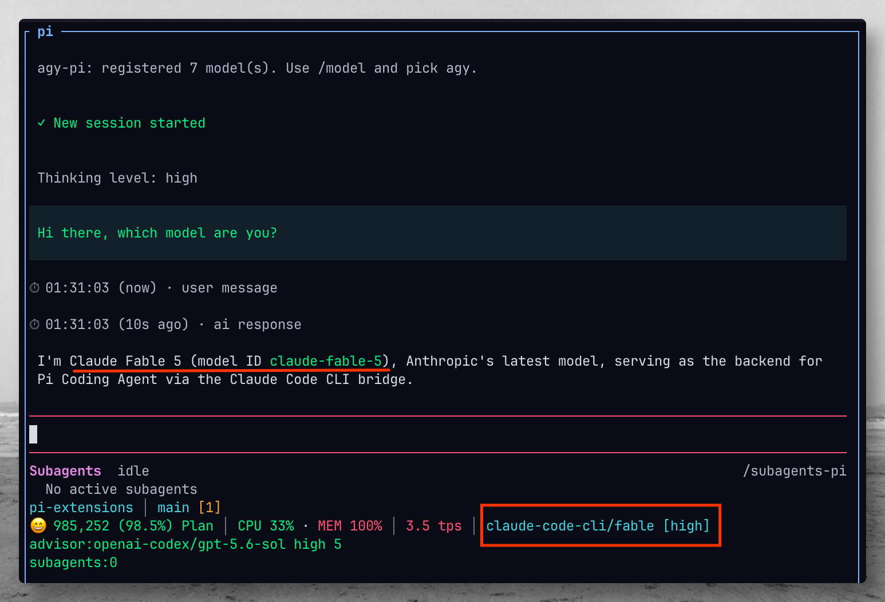

# claude-code-pi

> **Note:** This extension spawns a fresh `claude -p` process for every model turn and does **not** maintain a persistent Claude Code session. See [Notes and limitations](#notes-and-limitations) for details on why caching and session persistence are intentionally disabled.



`claude-code-pi` registers a `claude-code-cli` provider in Pi and delegates every model call to the local Claude Code CLI with `claude -p` / `--print`.

This extension is intentionally a CLI bridge. It does **not** use the Anthropic SDK, direct HTTP APIs, or Pi's built-in Claude provider as a fallback. If `claude -p` is unavailable or fails, the Pi model turn fails with setup guidance instead of silently using another transport.

## Requirements

- Pi Coding Agent
- Claude Code CLI installed and available on the same machine:

```bash
claude --version
```

- Claude Code authenticated/configured according to your local Claude Code setup.

## Install

From this repository:

```bash
npm run install-extensions
```

Then restart Pi or run:

```text
/reload
```

For one-off development testing without copying:

```bash
pi -e ./extensions/claude-code-pi/src/index.ts
```

## Usage

Pick provider **`claude-code-cli`** from `/model`, or start Pi directly:

```bash
pi --provider claude-code-cli --model sonnet
```

Bundled model aliases mirror common Claude Code CLI `--model` aliases:

| Pi provider | Pi model id | Passed to Claude Code |
|-------------|-------------|-----------------------|
| `claude-code-cli` | `sonnet` | `claude -p --model sonnet` |
| `claude-code-cli` | `opus` | `claude -p --model opus` |
| `claude-code-cli` | `fable` | `claude -p --model fable` |

Print-mode smoke test:

```bash
pi -p --provider claude-code-cli --model sonnet "Reply with exactly OK"
```

Direct Claude Code transport check:

```bash
claude -p --model sonnet --no-session-persistence --tools "" "Reply with exactly OK"
```

Commands:

```text
/claude-code-pi status
/claude-code-pi models
/claude-code-pi test
/claude-code-pi help
```

In the TUI, bare `/claude-code-pi` opens a read-only menu with the last in-memory Claude Code CLI status (or not checked), configuration-source presence, registered model count, and safe availability status (registered does not prove CLI model availability), plus navigation/help and Close. The panel never runs status probes, refresh/update/test/login/model calls, spawns Claude Code, or edits environment/model-file credentials. It shows only safe presence/status information: API keys, auth contents, credential values, URLs, stderr, and user emails are not displayed. Escape or Close exits the panel. Detail views show one short display segment per page (long records continue on the next page without losing text); use Previous/Next to navigate and Back to return to the sections. Non-TUI bare `/claude-code-pi` and every explicit subcommand keep their existing behavior.

## Configuration

| Environment variable | Description |
| -------------------- | ----------- |
| `CLAUDE_CODE_PI_BIN` | Override the Claude Code executable path. Defaults to `claude`. |
| `CLAUDE_CODE_PI_MODELS` | Comma- or space-separated model aliases to register. Defaults to `sonnet,opus,fable`. |
| `CLAUDE_CODE_PI_TIMEOUT_MS` | Per-turn `claude -p` timeout in milliseconds. Defaults to 300000. |
| `CLAUDE_CODE_PI_CONTEXT_WINDOW` | Override the advertised context window in tokens. Defaults to 1000000 (current Claude aliases serve 1M-token context windows). |

Example:

```bash
CLAUDE_CODE_PI_MODELS="sonnet,opus,claude-fable-5" pi
```

## Thinking levels

Pi thinking levels map to Claude Code's `--effort` flag:

| Pi thinking level | Passed to Claude Code |
|-------------------|-----------------------|
| `off` / unset     | no `--effort` flag    |
| `minimal`, `low`  | `--effort low`        |
| `medium`          | `--effort medium`     |
| `high`            | `--effort high`       |
| `xhigh`           | `--effort xhigh`      |

## Images

Models advertise image input. When a turn contains images, the extension switches to the stream-json transport (`--input-format stream-json --output-format stream-json --verbose`) and sends images as base64 content blocks over stdin. Text-only turns keep the plain-text transport.

## How it works

For each Pi model turn, the extension:

1. Serializes Pi's system prompt, conversation transcript, and available tool schemas into one text prompt.
2. Spawns the local Claude Code CLI with `claude -p --model <selected> --no-session-persistence --tools "" --output-format text`, plus `--effort <level>` when a thinking level is set.
3. Writes the serialized prompt (or a stream-json user message with base64 image blocks) to Claude Code over stdin.
4. Converts Claude Code stdout into a Pi assistant text message, or converts `<pi_tool_call>{...}</pi_tool_call>` markers into native Pi tool calls.
5. Emits a clear assistant error if the CLI is missing, exits non-zero, is aborted, or times out.

The extension disables Claude Code's own tools with `--tools ""`. Pi tool schemas are included in the prompt, and explicit `<pi_tool_call>{...}</pi_tool_call>` markers are handed back to Pi so Pi executes tools through its normal pipeline.

## Notes and limitations

- This is slower than native HTTP providers because a `claude -p` process starts for each model turn.
- Tool calling is prompt-bridged with `<pi_tool_call>{...}</pi_tool_call>` markers, so it is less reliable than native provider tool calling but still keeps execution in Pi.
- Image input requires the stream-json transport and is supported for base64 image blocks; availability checks use `claude --version`, so real model calls may still fail if local Claude Code auth or account access is not configured.
- **No persistent session or context cache.** The extension passes `--no-session-persistence` and spawns a new `claude -p` subprocess per turn. The full conversation transcript is re-serialized into the prompt each turn, so Claude Code's internal KV cache provides no benefit — the prefix is always re-sent. The only potential gain from a persistent process would be eliminating ~1–2 s of per-turn binary startup overhead, not token caching.

## Anthropic terms of service analysis

Checked against Anthropic's published terms and the Claude Code legal page:

- [Consumer Terms of Service](https://www.anthropic.com/legal/consumer-terms) (Free, Pro, Max)
- [Commercial Terms of Service](https://www.anthropic.com/legal/commercial-terms) (API keys, Team, Enterprise)
- [Claude Code legal and compliance](https://code.claude.com/docs/en/legal-and-compliance)
- [Usage Policy](https://www.anthropic.com/legal/aup), including the [2026 update](https://www.anthropic.com/news/2026-usage-policy-update) published October 8, 2026 and effective November 12, 2026
- [Use the Claude Agent SDK with your Claude plan](https://support.claude.com/en/articles/15036540-use-the-claude-agent-sdk-with-your-claude-plan) (support article, updated October 7, 2026)

| Rule | Source | How this extension relates |
|---|---|---|
| No automated access by bot or script, unless through an API key or where Anthropic explicitly permits it | Consumer Terms §3.7 | ✅ Anthropic explicitly permits `claude -p` with a subscription: the support article says Agent SDK, `claude -p`, and third-party app usage draw from your plan's limits. With an API key, this clause does not apply. |
| The binary must not be modified, and its built-in sign-in methods must not be removed or disabled | Claude Code legal page | ✅ Runs the unmodified, published `claude` binary and leaves its authentication alone. |
| OAuth sign-in is for ordinary use of Claude Code. Developers may not collect, store, or intermediate Claude credentials or session tokens. | Claude Code legal page, "Authentication and credential use" | ✅ Never reads, copies, or refreshes OAuth tokens. Sign-in happens only inside Claude Code. |
| No reselling or proxying Claude through services that route requests through consumer subscriptions or misrepresent the client being used | Usage Policy | ✅ Personal use routes only your own requests through your own sign-in, and the real `claude` client makes every call. ⚠️ Running it as a shared backend for other people would cross this line. |
| No paying for, reselling, or intermediating Claude usage for end users. Each user must sign in with their own credentials. | Claude Code legal page, "Can customers offer Claude Code in their products?" | ⚠️ Fine when each person runs it with their own account. Do not ship it as a service that runs on your subscription. |
| Advertised Pro and Max limits assume ordinary, individual use of Claude Code and the Agent SDK | Claude Code legal page | ⚠️ Every Pi turn is a full `claude -p` call that re-sends the transcript, so long agent sessions use up plan limits faster than interactive Claude Code. |

### Conclusion

**Safe for personal use with your own credentials.** The design follows the path Anthropic permits: a real `claude -p` subprocess per turn, no token extraction, no direct API calls, and no fallback transport.

**Residual risks:**

1. **Heavy automated use on a subscription.** `claude -p` on a Pro or Max plan is allowed and still draws from your normal plan limits. Anthropic announced a separate Agent SDK credit pool for this traffic and then paused that change on June 15, 2026. Long-running or unattended loops still go beyond the "ordinary, individual usage" that those limits assume. For heavy automation, use an Anthropic API key in Claude Code: that usage falls under the Commercial Terms and removes the ambiguity. Since October 7, 2026, Max and Team plans include monthly API credits that also cover `claude -p`. Pro and Free plans do not get these credits.
2. **Distributing it to others.** Letting other people route their requests through your subscription, or hosting it as a service, counts as intermediating Claude, which Anthropic actively enforces against. Each user must run it with their own account or API key.
3. **Tool execution.** `--tools ""` and `--permission-mode dontAsk` only stop Claude Code itself from running or prompting for tools. Tool calls the model requests are executed by Pi under Pi's own permission settings. This is an operational safety point, not a terms issue.

**Verdict: safe for personal use with your own credentials. Use an API key, or the API credits included with Max and Team, for heavy automation. Do not ship it as a subscription-backed backend for other users.**

*Last reviewed October 20, 2026 against anthropic.com/legal/consumer-terms, anthropic.com/legal/commercial-terms, anthropic.com/legal/aup (2026 update effective November 12, 2026), code.claude.com/docs/en/legal-and-compliance, and the Claude support article on Agent SDK plan usage (updated October 7, 2026). Terms and enforcement practices may change.*
